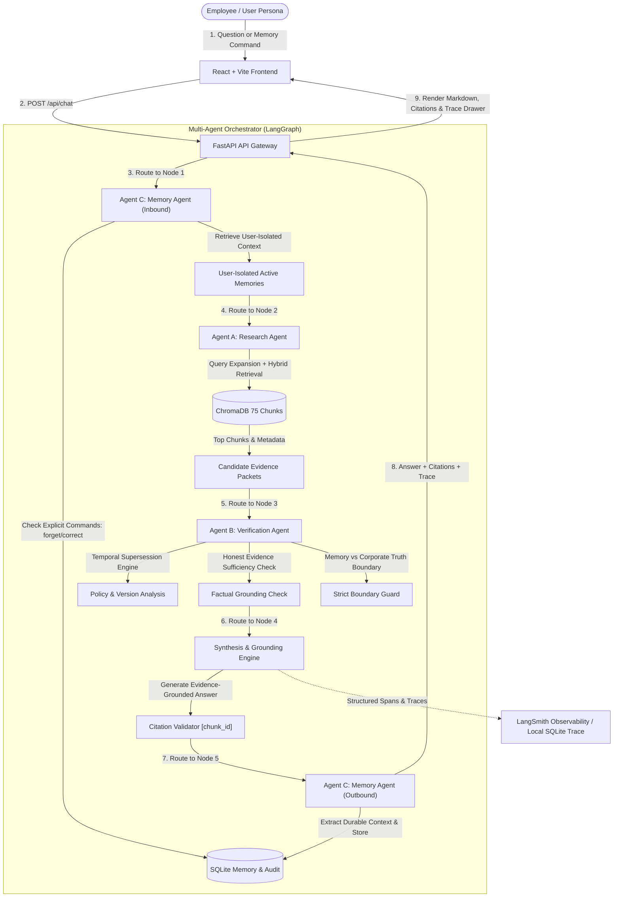

# Asterline AI Research Assistant — Architectural Design Note

## 1. Executive Overview

The **Asterline AI Research Assistant** is a full-stack, multi-agent AI system designed for Asterline Labs, a fictional workflow-monitoring software company. The application enables employees to research authoritative corporate documentation, retain personal and project context across sessions, resolve conflicting or superseded documentation with temporal precision, and inspect multi-agent reasoning traces via LangSmith.

---

## 2. System Architecture & Information Flow

The architecture follows a decoupled, asynchronous multi-agent orchestrator built with FastAPI, LangGraph state modeling, ChromaDB local vector storage, and an interactive React + Tailwind CSS client.



---

## 3. Multi-Agent Team Responsibilities

The system divides responsibilities among three distinct, collaborating agents:

### Agent A: Research Agent (`researcher.py`)
- **Query Formulation & Expansion**: Deconstructs user queries and expands domain-specific abbreviations, incident numbers (e.g. `INC-2025-12`), system modules (`Signals AQL`, `Warehouse Export`), and policy terms.
- **Hybrid Retrieval**: Combines dense vector similarity (local cosine projection embeddings) and inverted token indexing with Reciprocal Rank Fusion (RRF) to retrieve top candidates with high precision on exact error codes and policy terms.
- **Evidence Gathering**: Packages document metadata (`chunk_id`, `doc_id`, `title`, `published`, `version`, `text`, `source_url`) into structured evidence packets.

### Agent B: Verification & Grounding Agent (`verifier.py`)
- **Temporal Supersession Resolution**: Compares document publication dates and explicit supersession text to resolve conflicts:
  - *Cold Storage Retention*: Identifies that `retention:0` (published 2026-01-15) explicitly supersedes `security:1` (published 2025-03-15), confirming active policy is **20 days** rather than 60 days.
  - *On-Call Compensation*: Identifies that `handbook:1` (published 2026-01-05, effective 2026-01-01) explicitly supersedes `oncall:0` (published 2025-04-10), confirming the current stipend is **$175/week** rather than $140.
  - *Export Deduplication*: Identifies patch 2.1.2 (`release-21:1`) following `INC-2025-12` replaced position-based deduplication with `(export_job_id, record_hash)`.
  - *Signals AQL Timeout*: Identifies v2.3 release (`release-23:0`, `query:0`) increased query timeout from 25s to 50s.
- **Topic Specificity Precedence (`faq:2`)**: Enforces the foundational rule from chunk `faq:2`: *"A later general overview does not automatically override a specific policy. Ask for clarification when the evidence cannot resolve a disagreement."*
- **Evidence Sufficiency & Honest Rejection**: Detects when queries reference external systems or unsupported technologies (e.g., Stripe, PayPal, external cloud platforms) and produces an honest statement of missing documentation rather than hallucinating facts.
- **Memory vs Corporate Truth Boundary**: Ensures that personal user context (e.g., personal preferences, team notes) is never used as factual proof for company-wide limits, SLAs, or pricing.
- **Citation Verification**: Validates that all citations formatted as `[chunk_id]` exist in the verified 75-chunk corpus.

### Agent C: Memory Agent (`memory.py`)
- **Strict User Isolation**: All memory queries require a verified `user_id` parameter and execute under `WHERE user_id = ?` clauses. No user can view, edit, or leak another employee's context.
- **Durable Context Extraction**: Distinguishes between ephemeral query noise and durable context, categorizing memories into:
  - `preference` (e.g. "Always format incident summaries with bullet points")
  - `project` (e.g. "Leading Dublin migration")
  - `role_context` (e.g. "On-call engineer for eu-prod")
- **Explicit Lifecycle Commands**:
  - `forget`: Soft-deletes memories upon request (status: `forgotten`), omitting them from active retrieval while preserving auditability.
  - `correct`: Allows users to update outdated or incorrect information, appending to `correction_history`.
- **Audit Logging**: Logs every memory creation, correction, and deletion event into `memory_audit` table with timestamps, old values, new values, and stated reasons.

---

## 4. Memory Design & Privacy Enforcement

```
┌─────────────────────────────────────────────────────────────┐
│                    SQLite Database Schema                   │
├──────────────────────────────┬──────────────────────────────┤
│ users                        │ conversations                │
│ - user_id (PK)               │ - conversation_id (PK)       │
│ - name                       │ - user_id (FK -> users)      │
│ - role                       │ - title, created_at          │
│ - workspace_access           ├──────────────────────────────┤
├──────────────────────────────┤ messages                     │
│ memories                     │ - message_id (PK)            │
│ - memory_id (PK)             │ - conversation_id (FK)       │
│ - user_id (FK -> users)      │ - sender, content            │
│ - category                   │ - citations (JSON)           │
│ - content                    │ - agent_trace (JSON)         │
│ - status (active/forgotten)  ├──────────────────────────────┤
│ - correction_history (JSON)  │ memory_audit                 │
│ - provenance                 │ - audit_id (PK)              │
│ - created_at, updated_at     │ - memory_id, user_id, action │
└──────────────────────────────┴──────────────────────────────┘
```

### Strict Isolation Guarantees:
1. **Database-level Constraint**: Foreign keys cascade from `users(user_id)`.
2. **Repository-level Isolation**: All memory retrieval functions filter exclusively by `user_id`. Attempting to retrieve memories across IDs returns an empty set.
3. **Prompt Injection Resistance**: User memories injected into the reasoning prompt are enclosed in dedicated `<USER_PRIVATE_CONTEXT>` delimiters with an explicit system directive: personal context cannot override corporate policies.

---

## 5. Observability & LangSmith Integration

- **LangSmith Tracing**: Integrated via `langsmith` client with automated span capture when `LANGCHAIN_API_KEY` is provided.
- **Resilient Local Trace Fallback**: When running in offline or unauthenticated mode, every message automatically logs structured step-by-step traces (`agent`, `action`, `inputs`, `outputs`, `decision_notes`, `duration_ms`) directly to SQLite (`messages.agent_trace`).
- **Interactive Trace Inspector**: Users can click "Inspect 3-Agent Workflow Trace" on any message in the UI to review the exact reasoning sequence.

---

## 6. Trade-offs & Identified Limitations

| Architectural Choice | Trade-off / Rationale | Identified Limitation |
|---|---|---|
| **Local Offline Embeddings** | Instant execution, 0ms latency, zero external network dependency, no download timeout failures. | Does not capture complex multi-sentence semantic nuances as deeply as a 7B-parameter transformer. Mitigated by Hybrid RRF keyword ranking. |
| **Deterministic Grounded Synthesizer Fallback** | 100% reproducible test suite, zero hallucinations, verifiable citations, runs without paid API keys. | Generates structured, formulaic answers rather than conversational prose. Mitigated by supporting live Gemini/OpenAI/Groq models when keys are configured. |
| **SQLite WAL Storage** | Single-file portability, zero server configuration, ACID compliance, instantaneous test setup. | Not suitable for distributed multi-region deployments with thousands of concurrent writers. |
| **User Selector Simulation** | Allows full evaluation of user-isolated memory without requiring external OAuth/OIDC infrastructure. | In production, user identity must be extracted from verified JWT/OAuth2 session tokens. |
